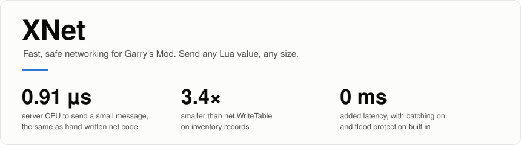
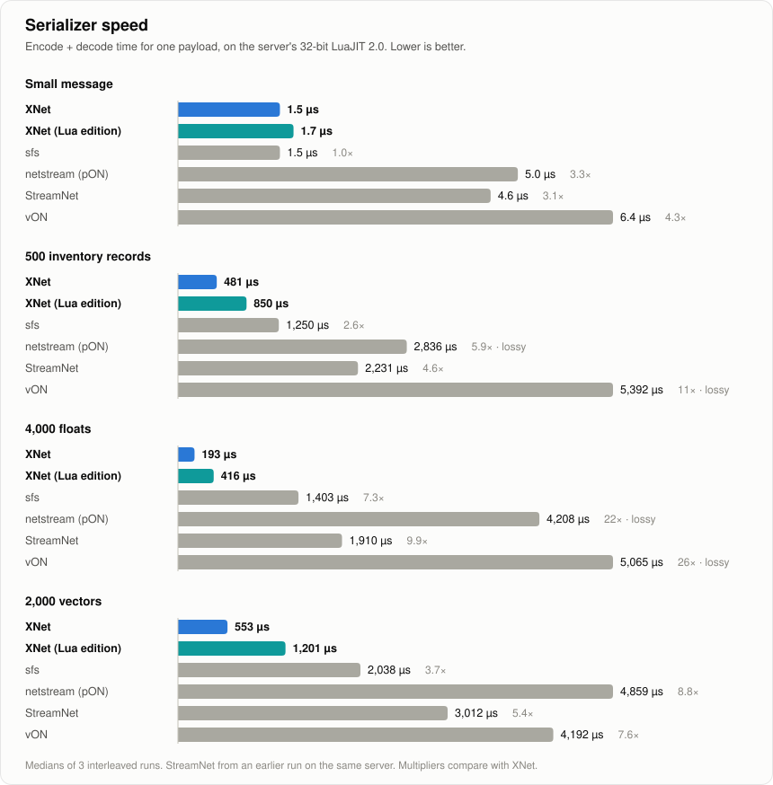
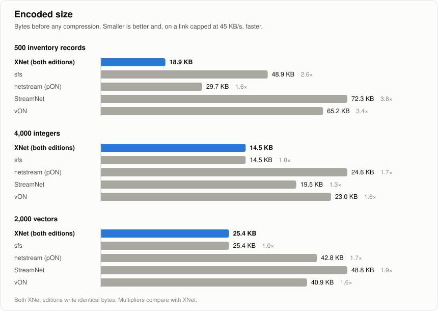
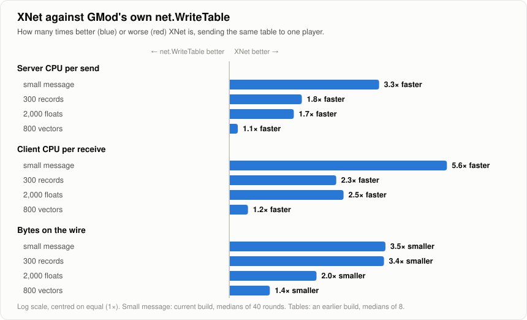

<p align="center">
  <picture>
    <source media="(prefers-color-scheme: dark)" srcset="assets/hero-dark.svg">
    
  </picture>
</p>

<p align="center">
  <a href="https://github.com/exliipso/XNet/releases/latest"><b>Download</b></a> ·
  <a href="#install">Install</a> ·
  <a href="#quick-start">Quick start</a> ·
  <a href="#api">API</a> ·
  <a href="#benchmarks">Benchmarks</a>
</p>

<p align="center">
  Created by <a href="https://github.com/exliipso">exliipso</a> · <a href="LICENSE">Apache License 2.0</a>
</p>

XNet sends Lua values between a Garry's Mod server and its clients: numbers, strings, nested tables, vectors, entities, at any size. It replaces `net.WriteTable`, netstream and similar libraries, and in the [benchmarks](#benchmarks) below it is the cheapest to send of all eight other libraries tested and `net.WriteTable`.

- **As cheap as hand-written net code.** A small message costs the server 0.91 µs to send, against 0.89 µs for typing out every `net.Write*` yourself and 2.3 µs or more for every other library.
- **Small on the wire.** 26 bytes for a message `net.WriteTable` sends in 90. Repeated strings are sent as short references, so arrays of records are 1.6 to 3.8 times smaller than with the other libraries.
- **Any size, never a disconnect.** Big messages are chunked and paced to the link, so they can't overflow a player's reliable buffer. The same pacing protects players from floods of small messages.
- **Safe with untrusted clients.** Per-name size and rate limits, bounded decompression, and a decoder that checks every length before it allocates.
- **Nothing for players to install.** Pure Lua on the client. The server can add an optional Rust module for faster encoding.

## Contents

- [Install](#install)
- [Quick start](#quick-start)
- [API](#api)
- [How it works](#how-it-works)
- [Configuration](#configuration)
- [Benchmarks](#benchmarks)
- [Correctness](#correctness)
- [Development](#development)
- [License and attribution](#license-and-attribution)

## Install

XNet comes in two editions with the same API. Both are on the [releases page](https://github.com/exliipso/XNet/releases/latest), packaged to be extracted straight into your server's `garrysmod` folder.

| | **Lua edition** | **Native edition** |
|---|---|---|
| Download | `xnet-lua-<version>.zip` | `xnet-native-<version>.zip` |
| Contents | `addons/xnet/lua/autorun/xnet.lua` | The same, plus `lua/bin/gmsv_xnet_*.dll` |
| Server | Encodes in Lua | Encodes in Rust, up to 7 times faster |
| Clients | Get the Lua file automatically | Get the Lua file automatically |

### Lua edition

1. Extract `xnet-lua-<version>.zip` into `garrysmod/`.
2. Restart the server.

Clients receive the file like any other addon's Lua. To check it loaded, run `lua_run print(XNet.Version)` in the server console.

### Native edition

1. Extract `xnet-native-<version>.zip` into `garrysmod/`. It holds the addon and one module per platform:

   | Server | Module |
   |---|---|
   | Linux, 32-bit (default srcds) | `gmsv_xnet_linux.dll` |
   | Linux, 64-bit (x86-64 branch) | `gmsv_xnet_linux64.dll` |
   | Windows, 32-bit | `gmsv_xnet_win32.dll` |
   | Windows, 64-bit | `gmsv_xnet_win64.dll` |

   Garry's Mod loads only the one that matches the server; the others can be deleted.
2. Restart the server. A loaded module is only replaced by a restart, not a map change.

`lua_run print(XNet.Native)` prints `true` when the module is in use. Without it XNet keeps working in Lua.

> [!NOTE]
> The 32-bit Linux module runs on a live server, and the 64-bit Windows module passes the full test suite on Garry's Mod's own LuaJIT. The 32-bit Windows and 64-bit Linux modules are built from the same code by CI but haven't been run on a server yet.

### Inside your own addon

Copy `lua/autorun/xnet.lua` into your addon. When several addons carry it, the first one loaded wins and the rest reuse it.

## Quick start

```lua
-- Server
XNet.Receive("shop.buy", function(ply, itemId, amount)
    print(ply:Nick() .. " wants " .. amount .. " of " .. itemId)
end, {maxBytes = 256, rate = 5})

XNet.Send(ply, "inventory.sync", inventory)       -- one player
XNet.Send({ply1, ply2}, "party.update", party)    -- several players
XNet.Broadcast("event.start", "Purge", 300)       -- everyone

-- Client
XNet.Receive("inventory.sync", function(inventory)
    PrintTable(inventory)
end)

XNet.Send("shop.buy", "weapon_ak47", 2)
```

Server callbacks get `(ply, ...)` and client callbacks get `(...)`. Arguments arrive exactly as sent, trailing `nil`s included, and messages to a player arrive in the order they were sent.

## API

| Function | |
|---|---|
| `XNet.Receive(name, callback [, options])` | Handle a message. Names are 1 to 255 characters. |
| `XNet.Send(target, name, ...)` | Server. `target` is a player, a list of players, or `nil` for everyone. |
| `XNet.Send(name, ...)` | Client, to the server. |
| `XNet.Broadcast(name, ...)` | Server, to everyone. |
| `XNet.Encode(...)` / `XNet.Decode(string)` | The wire format on its own, for files or databases. |
| `XNet.Queued([ply])` | Bytes still waiting to go out to a player. |
| `XNet.Version`, `XNet.Native` | The version, and whether the native module is encoding. |

**Receive options** (server only, for what clients send):

| Option | Default | |
|---|---|---|
| `maxBytes` | 64 KB | Largest message accepted, measured after decompression. |
| `rate` | 30 | Messages per second per player. `0` turns the limit off. |
| `burst` | 60 | Messages a player can send at once before `rate` applies. |

**Values it sends:** `nil`, booleans, numbers, strings (any bytes), tables (nested, array and hash parts), `Vector`, `Angle`, `Color`, entities and players. Numbers arrive exactly, except subnormals (below 2.2e-308), which the 32-bit server's compiled code can turn into zero. A table that contains itself is refused with an error.

**Hook:** `XNet.Rejected (ply, name, reason)` fires on the server whenever a client message is refused: unknown name, too big, rate limit, or a bad payload.

## How it works

### Batching

On the server, the small messages a player gets during a frame are joined into one net message, so the engine's per-message cost (`net.Start`, `net.Send` and each message's header on the wire) is paid once per player per frame.

Nothing waits for a later frame. A server frame handles incoming messages, then Think, timers and the Tick hook, and sends packets at the end. XNet writes its batches in its Tick hook, and anything sent after that goes out directly. Order is kept with every other net message: any `net.Start`, from any addon, writes pending batches first. Set `XNet.Config.Batch = false` to send every message on its own.

### Big messages and flow control

Garry's Mod sends any net message bigger than a packet as split packets, no faster than the server's `net_splitpacket_maxrate` (45 KB/s by default). Anything sent faster piles up in the player's reliable buffer, and when that overflows the player is disconnected.

XNet cuts big messages into chunks and the receiver confirms what it has. Only about 0.2 seconds of the link is ever unconfirmed per player, so transfers run as fast as the link drains and never overflow it. Small messages count toward the same window, which is why a loop sending thousands of them can't disconnect anyone either. Payloads of 32 KB or more are LZMA-compressed when a sample shows it pays off.

### Safety

Everything a client sends is untrusted. On the server:

- **Unknown names** are dropped before a byte is buffered: only names with an `XNet.Receive` are accepted.
- **Size limits** apply per name, and compressed data is limited inside the decompressor, so a zip bomb never inflates.
- **Rate limits** apply per player and name.
- **One transfer** is in flight per player, and a stalled one is dropped after 30 seconds.
- **The decoder** checks every length and count against the bytes actually present and limits nesting, so a hostile payload can't make it allocate more than its own size.
- **A broken handler** is reported with its stack and doesn't affect other messages, even inside a batch.

### The native module

`gmsv_xnet` encodes on the server in Rust and writes exactly the bytes the Lua edition writes, so clients decode with Lua and players never download a binary. It never raises a Lua error through Rust code, reads only what the module ABI guarantees, and falls back to Lua for anything it can't read itself. See [`native/src`](native/src).

## Configuration

`XNet.Config` holds the defaults. Change them before sending, on whichever side needs them.

| Key | Default | |
|---|---|---|
| `Batch` | `true` | Server: join a player's small messages each frame. |
| `CompressAt` | 32 KB | Payloads this big are LZMA-compressed when a sample shrinks by 15% or more. |
| `Window`, `ChunkSize` | from the link | Unconfirmed bytes per player, and chunk size. By default 0.2 s of `net_splitpacket_maxrate` (32 to 192 KB), chunks a quarter of that. |
| `MaxQueued` | 32 MB | Bytes waiting per player before `Send` refuses. |
| `MaxDepth` | 64 | Table nesting limit. |
| `ClientMaxBytes`, `ClientRate`, `ClientBurst` | 64 KB, 30, 60 | Defaults for names whose `Receive` sets no options. |
| `StallTimeout`, `Timeout` | 10 s, 30 s | When an unresponsive player's window reopens, and when a stalled incoming transfer is dropped. |

## Benchmarks

Measured on a live Garry's Mod server with a real client connected: a 32-bit LuaJIT 2.0.4 server at 66 tick, a 64-bit client, about 20 ms of ping. Every library used its own encoder, compression and transport, and every message was checked on arrival.

<details>
<summary><b>Libraries tested</b></summary>

| Library | Version | What it is |
|---|---|---|
| [netstream 2](https://github.com/alexgrist/netstream) | upstream, with pON | The common `netstream.Start` / `netstream.Hook` wrapper. Upstream sends one net message per call, so the copy tested adds chunking for payloads over 64 KB. |
| [ChrononLabs StreamNet](https://github.com/InfHorus/Chrononlabs-StreamNet) | `03c27a5` | Chunked transfers over unreliable packets, with resends. |
| [vNet](https://github.com/vercas/vNet-for-GMod) | 1.1.5, `dace93e` | A packet library on vON that buffers through files. |
| [sfs](https://github.com/wrefgtzweve/sfs) | 7.0.9, `f7d165d` | Srlion's binary serializer (a re-upload; the original repository was deleted), sent with `net.WriteData`. |
| [vON](https://github.com/vercas/vON) | 1.3.4, `95e7f76` | vNet's serializer, on its own. |
| [net_compressed_table](https://github.com/yupi2/net_compressed_table) | `2c1f79f` | vON plus LZMA in place of `net.WriteTable`. |
| [bNet](https://github.com/codeisblue/bNet) | `c99aab5` | A wrapper over `net.WriteType`. |
| [FreeNet](https://github.com/Mista-Tea/freenet) | `619652c` | A wrapper over the typed `net.Write*` functions. |
| `net.WriteTable` | Garry's Mod | The built-in way to send a table. |

Two more were found and left out: [NetStreamV2](https://github.com/SillyDev2026/NetStreamV2) is a Roblox library, and [neet](https://github.com/UAVXP/neet) lets any client register network strings, which can exhaust the server's string table.

</details>

### One small message

<picture>
  <source media="(prefers-color-scheme: dark)" srcset="assets/small-dark.svg">
  
</picture>

XNet is the only library that costs about the same as writing each field by hand, thanks to [batching](#batching). A message sent alone, with nothing else for that player in the frame, costs about 1.5 µs; `net.Start` and `net.Send` take 0.29 µs of that by themselves.

<details>
<summary><b>Every number</b></summary>

`42, "hello world", true, {x = 1, y = 2}` to one player, 150 per frame, medians of 40 rounds.

| | Server CPU | Client CPU | Bytes |
|---|---|---|---|
| **XNet**, native edition | **0.91 µs** | **0.33 µs** | **26** |
| **XNet**, Lua edition | 1.05 µs | 0.33 µs | 26 |
| Hand-written `net.Write*` | 0.89 µs | 0.33 µs | 28 |
| sfs + `net.WriteData` | 2.26 µs | | 29 |
| FreeNet ¹ | 2.33 µs | | 45 |
| bNet ² | 2.82 µs | | 61 |
| `net.WriteTable` | 2.99 µs | 1.86 µs | 90 |
| netstream | 5.22 µs | | 50 |
| net_compressed_table ³ | 302 µs | | 59 |

Client CPU wasn't measured for the third-party libraries. ¹ Sends every number as a 32-bit float, so integers above 16,777,216 arrive changed. ² Prints every message it receives to the console. ³ Runs LZMA on every message, however small.

From an earlier build, before batching: 300 small messages sent at once were all delivered in 125 ms by XNet and 110 ms by netstream; StreamNet delivered 24 (it refuses more than 24 transfers in flight per player) and vNet took 6.95 s.

</details>

### Serializer

<picture>
  <source media="(prefers-color-scheme: dark)" srcset="assets/serializer-dark.svg">
  
</picture>

<picture>
  <source media="(prefers-color-scheme: dark)" srcset="assets/size-dark.svg">
  
</picture>

sfs is the closest competitor: it ties on the small message, decodes a few payloads slightly faster, and writes a few bytes less on most. XNet encodes 1.2 to 14 times faster, and because repeated strings go as short references, arrays of records come out 2.6 times smaller than with sfs.

**Why XNet over sfs?** sfs is a serializer and a good one, but it stops at turning values into a string. Everything after that is still yours to write, and that's where XNet does most of its work:

- **Sending is 2.5 times cheaper.** A small message costs 0.91 µs with XNet against 2.26 µs for sfs plus `net.WriteData`, because XNet batches a player's messages into one net message.
- **Big payloads just work.** sfs output still has to fit in one 64 KB net message. XNet chunks anything bigger, compresses it when that pays off, and paces it so a player is never disconnected.
- **Inventories travel smaller.** With string references, records are 2.6 times smaller on the wire, which matters on a link capped at 45 KB/s.
- **Client input is policed for you.** Unknown message names are dropped, and every name gets size and rate limits plus the `XNet.Rejected` hook.
- **The server can encode in Rust.** That's 3.5 to 14 times faster than sfs on tables, with no change for players.

<details>
<summary><b>Every number</b> (server, microseconds per payload, medians of 3 interleaved runs)</summary>

| Payload | | **XNet** native | **XNet** Lua | sfs | pON | vON | StreamNet ¹ | vNet ¹ |
|---|---|---|---|---|---|---|---|---|
| Small message | encode / decode | **0.6** / 0.9 | **0.6** / 1.1 | 0.9 / **0.6** | 2.8 / 2.2 | 3.9 / 2.5 | 3.5 / 1.1 | 162 / 173 |
| | bytes | 26 | 26 | **24** | 38 | 37 | 57 | 60 |
| 500 records | encode / decode | **257 / 225** | 592 / 259 | 929 / 321 | 1,533 / 1,304 ² | 3,319 / 2,073 ² | 1,842 / 389 | 2,099 / 2,006 |
| | bytes | **19,379** | **19,379** | 50,097 | 30,421 | 66,718 | 74,008 | 30,898 |
| 4,000 floats | encode / decode | **148 / 45** | 354 / 62 | 1,317 / 86 | 2,644 / 1,564 ² | 2,512 / 2,554 ² | 1,808 / 102 | 1,226 / 909 |
| | bytes | 36,006 | 36,006 | 36,002 | 63,583 | 63,579 | 36,008 | **36,001** |
| 4,000 integers | encode / decode | **170** / 84 | 180 / 83 | 600 / 70 | 1,014 / 732 | 2,081 / 1,370 | 1,076 / **67** | 1,249 / 931 |
| | bytes | 14,828 | 14,828 | **14,827** | 25,240 | 23,572 | 20,008 | 36,001 |
| 2,000 unique strings | encode / decode | **174 / 42** | 342 / 44 | 217 / 65 | 787 / 257 | 755 / 387 | 575 / 53 | 1,093 / 2,475 |
| | bytes | 36,899 | 36,899 | **36,895** | 38,899 | 38,895 | 44,901 | 44,894 |
| 2,000 vectors | encode / decode | **94** / 459 | 686 / 515 | 1,330 / 708 | 2,777 / 2,082 | 2,523 / 1,669 | 2,565 / **447** | 1,605 / 1,663 |
| | bytes | 26,006 | 26,006 | 26,002 | 43,838 | 41,834 | 50,008 | **26,001** |
| 256 KB string | encode / decode | **27 / 19** | 34 / 26 | 32 / 27 | 1,727 / 1,623 | 1,571 / 126,364 | 40 / 31 | 906 / 558 |

¹ From an earlier run on the same server; the other columns come from one run. ² pON and vON write numbers as text and round most decimals: in a strict check, 12,900 of 18,000 values came back slightly different. XNet, sfs and StreamNet are exact.

Both XNet editions decode with the same Lua code, so the gap between their decode columns is run-to-run noise.

</details>

### Big transfers

<picture>
  <source media="(prefers-color-scheme: dark)" srcset="assets/transfers-dark.svg">
  
</picture>

At the server's default 45 KB/s split-packet rate, XNet moves data as fast as the link drains. Chunked netstream sends every chunk at once, and a 1 MB payload disconnected the test client. StreamNet sends chunks unreliably and resends what doesn't arrive; even its slowest profile (96 KB/s) outruns this link, and it gave up with "Maximum retries reached" on both big transfers, after sending 2.3 MB for a 780 KB one.

### Against `net.WriteTable`

<picture>
  <source media="(prefers-color-scheme: dark)" srcset="assets/writetable-dark.svg">
  
</picture>

<details>
<summary><b>Every number</b> (tables from an earlier build, medians of 8, server to one client)</summary>

| Payload | | `net.WriteTable` | **XNet** |
|---|---|---|---|
| Small message | server CPU / client CPU | 2.99 µs / 1.86 µs | **0.91 µs / 0.33 µs** |
| | bytes | 90 | **26** |
| 300 records | server CPU / client CPU | 865 µs / 547 µs | **487 µs / 234 µs** |
| | bytes · delivered in | 39,644 · 241 ms | **11,585 · 211 ms** |
| 2,000 floats | server CPU / client CPU | 541 µs / 281 µs | **324 µs / 113 µs** |
| | bytes · delivered in | 36,006 · 605 ms | **18,012 · 454 ms** |
| 800 vectors | server CPU / client CPU | 337 µs / 274 µs | **315 µs / 236 µs** |
| | bytes · delivered in | 14,404 · 257 ms | **10,413 · 256 ms** |

</details>

## Correctness

- **Exact values.** Every type round-trips exactly on the server and the client: integer boundaries, ±0, NaN, infinities, strings with every byte value, nested and mixed tables, and engine types. 20,000 random values, entities, vectors and angles included, round-trip on the live 32-bit server.
- **Two editions, one format.** The native and Lua encoders agree byte for byte on 15,000 random and edge-case values, and 13,000 decode back to what was sent.
- **The 32-bit server's quirks.** Its LuaJIT 2.0 miscompiles common ways of packing numbers once code runs hot, and runs with denormals treated as zero. XNet's number code is written around both and was checked in hot loops on that server.
- **Hostile input.** Tens of thousands of random, truncated and mutated payloads and random batches all fail cleanly.
- **Transport.** 54 end-to-end tests over a simulated network cover chunking, the window, batching and ordering, rate limits, disconnects and malformed input, run against both a native and a Lua-only server.

## Development

The native module builds with the nightly toolchain pinned in `native/rust-toolchain.toml`:

```bash
cd native && cargo build --release
```

`native/harness` runs the module and the Lua edition together on Garry's Mod's own LuaJIT (`bin/win64/lua_shared.dll`) over a simulated network, with no server:

```bash
cd native/harness && bash run.sh native.lua stress.lua transport.lua bench.lua
```

| Script | |
|---|---|
| `native.lua` | The module's contract: errors, batch buffers, re-entrancy, number bit patterns. |
| `stress.lua` | Native and Lua encoders agree byte for byte, and every value decodes back to itself. |
| `transport.lua` | End to end: chunking, the window, batching, ordering, limits, hostile input. |
| `bench.lua` | Hot-path timings, for comparing builds. |

`XNET_LUA_SERVER=1` runs the transport tests with a Lua-only server, and `XNET_DLL=<path>` tests a built module, such as a release's `gmsv_xnet_win64.dll`, instead of the code compiled into the harness. `cargo test --lib` covers the encoder's primitives, and CI also checks formatting and clippy.

The charts are generated from `assets/charts/data.json` by `node assets/charts/make.js`. A `v*` tag makes CI build the four modules and both zips and publish the release.

## License and attribution

XNet is licensed under the [Apache License, Version 2.0](LICENSE). Copyright 2026 [exliipso](https://github.com/exliipso), its original developer. See also [NOTICE](NOTICE).

**You may** use XNet in personal and commercial projects, modify it, redistribute it, and fork it under any name. You don't have to advertise or credit XNet anywhere just because you use it.

**When you redistribute XNet or a work based on it**, in source or compiled form, Apache 2.0 Section 4 requires you to:

- Include a copy of the [license](LICENSE).
- Keep the existing copyright, license and attribution notices, including the headers in XNet's source files, in the parts that come from XNet.
- Include the attribution notices from the [NOTICE](NOTICE) file, for example in a NOTICE file of your own.
- Mark files you changed with a prominent notice saying so.

Forks are welcome, under any name. Add your own copyright notice for the changes you make and leave the existing notices in place. Files you write from scratch don't need XNet's header.

The license doesn't grant rights to the XNet name or logo (Section 6), beyond what's needed to describe where the code comes from.

The native modules include third-party components under the MIT and ISC licenses; their notices are in [THIRD-PARTY-NOTICES.txt](THIRD-PARTY-NOTICES.txt) and ship with every native release.
